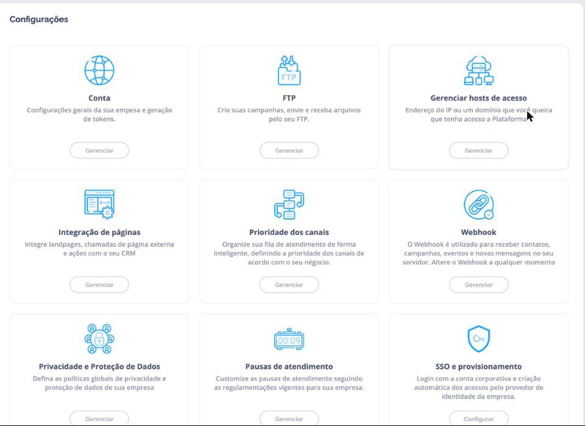
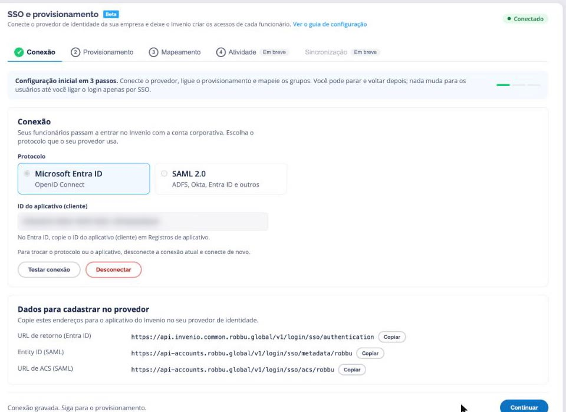
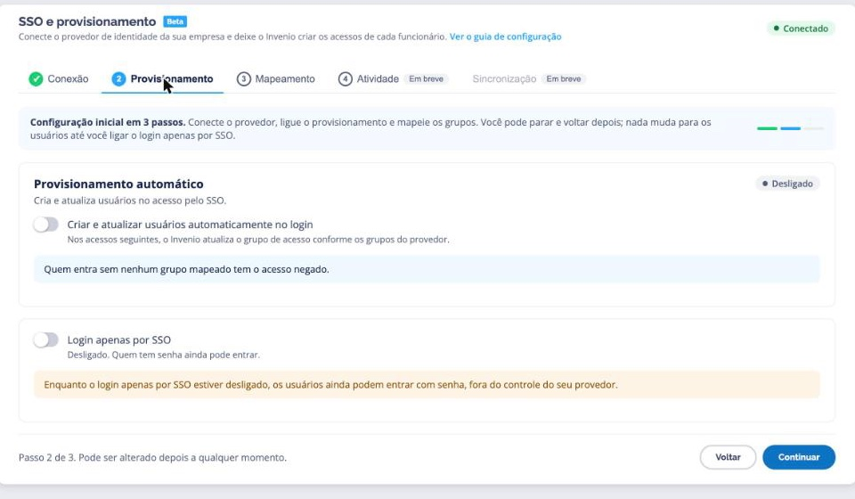
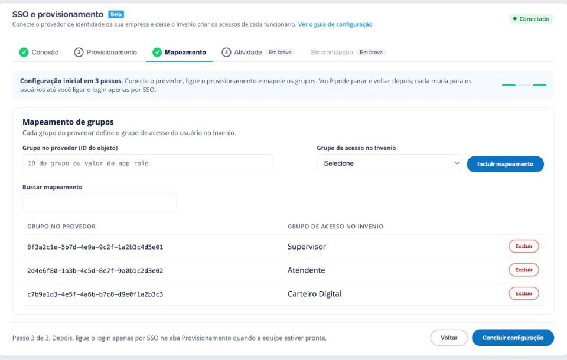
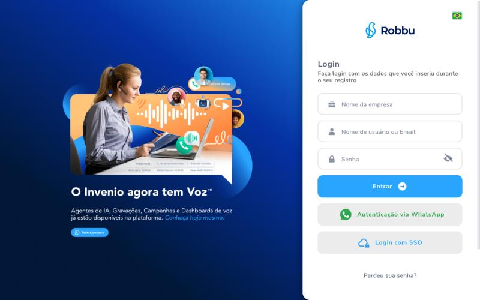
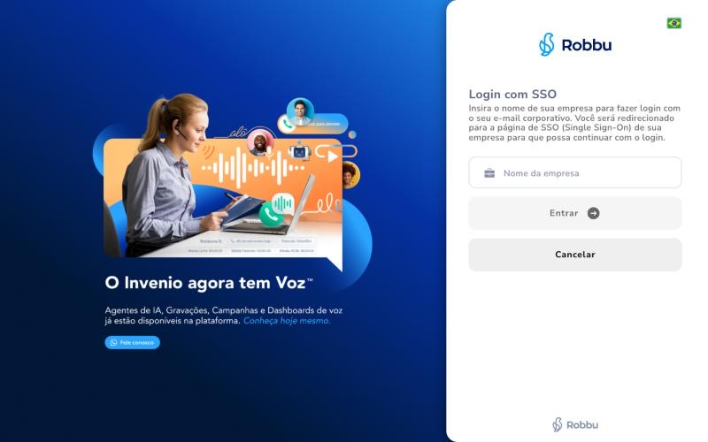

A funcionalidade de **Single Sign-On (SSO)** permite que os usuários autentiquem-se na plataforma Invenio utilizando suas **credenciais corporativas** já existentes, eliminando a necessidade de múltiplas senhas.

**Benefícios do SSO:**

- 🔐 **Segurança:** Autenticação centralizada e controlada
- 🚀 **Praticidade:** Login único para múltiplos sistemas
- 👥 **Gestão simplificada:** Controle de acesso centralizado
- ✅ **Conformidade:** Alinhamento com políticas corporativas

---

## Provedores Suportados

A plataforma Invenio by Robbu atualmente suporta autenticação SSO com os seguintes provedores de identidade:

<Tabs>
  <Tab title="Microsoft Entra ID" icon="microsoft">
    ### Microsoft Entra ID
    
    **Protocolo:** OpenID Connect (OIDC)
    
    **Baseado em:** OAuth 2.0
    
    **Ideal para:** Organizações que já utilizam Azure Active Directory
  </Tab>
  
  <Tab title="JumpCloud" icon="cloud">
    ### JumpCloud
    
    **Protocolo:** SAML 2.0
    
    **Ideal para:** Empresas que usam JumpCloud como diretório central
  </Tab>
  
  <Tab title="ADFS" icon="server">
    ### Active Directory Federado (ADFS)
    
    **Protocolo:** SAML 2.0
    
    **Ideal para:** Organizações on-premise com infraestrutura Windows Server
  </Tab>
</Tabs>

---

## Integração com Microsoft Entra ID

A integração com **Microsoft Entra ID** (anteriormente Azure AD) usa o protocolo **OpenID Connect (OIDC)** e é configurada pelo próprio cliente, no Invenio Center, sem abrir chamado.

### Onde configurar

No Invenio Center, abra o menu do seu usuário e vá em **Configurações > SSO e provisionamento > Configurar**.

<Frame caption="Cartão SSO e provisionamento em Configurações, no Invenio Center">
  
</Frame>

<Note>
**Quem acessa:** administradores e supervisores da empresa. Os demais usuários não veem a tela.
</Note>

A configuração tem **3 passos**, nas abas **Conexão**, **Provisionamento** e **Mapeamento**. Você pode parar e voltar depois. Nada muda para quem entra com senha até você ligar o **Login apenas por SSO**.

### Passo 1: Conexão

Na aba **Conexão**, escolha o protocolo **Microsoft Entra ID** e conecte de uma das duas formas.

<Tabs>
  <Tab title="Conectar com a Microsoft">
    Forma mais simples: não precisa criar registro de aplicativo.

    <Steps>
      <Step title="Clique em Conectar com a Microsoft">
        Na aba **Conexão**, clique em **Conectar com a Microsoft**.
      </Step>
      <Step title="Autorize com um administrador do Entra ID">
        Entre com uma conta de **administrador do Microsoft Entra ID** da sua empresa e aceite as permissões do aplicativo do Invenio.

        A permissão de leitura de grupos serve para o Invenio conferir os grupos do usuário no login. O Invenio só lê, e nunca escreve nada no seu Entra ID.
      </Step>
      <Step title="Confira o status">
        De volta ao Center, a conexão aparece como **Conectado com a Microsoft**, com o ID do locatário (tenant) conectado.
      </Step>
    </Steps>

    <Warning>
    **Grupos com membros ocultos:** nesta forma de conexão, não mapeie grupo com membros ocultos. O Invenio não enxerga os membros desse grupo e trata o usuário como fora dele.
    </Warning>
  </Tab>
  <Tab title="Registro de aplicativo próprio">
    Use quando a sua empresa prefere manter um aplicativo próprio no Entra ID.

    <Steps>
      <Step title="Crie o registro de aplicativo">
        1. No [Portal do Azure](https://portal.azure.com), abra **Microsoft Entra ID > App registrations > New registration**.
        2. **Name:** `Invenio SSO` (ou o nome que preferir).
        3. **Supported account types:** **Accounts in this organizational directory only (Single tenant)**.
        4. **Redirect URI:** tipo **Web**, com a **URL de retorno (Entra ID)** que a tela mostra em **Dados para cadastrar no provedor**:

        ```
        https://api.invenio.common.robbu.global/v1/login/sso/authentication
        ```

        5. Clique em **Register**.

        <Warning>
        **URL exata:** qualquer diferença na Redirect URI impede o login.
        </Warning>
      </Step>
      <Step title="Ligue a emissão de ID tokens">
        Em **Authentication > Implicit grant and hybrid flows**, marque **ID tokens** e salve.
      </Step>
      <Step title="Inclua os grupos no token (para o provisionamento)">
        Em **Token configuration > Add groups claim**, escolha **Groups assigned to the application** e marque o **ID token**.

        Alternativa: use **App roles** e atribua usuários ou grupos a elas. O Invenio lê as duas formas.

        <Tip>
        **Por que "Groups assigned to the application":** quando o usuário está em grupos demais, o Entra deixa de mandar a lista no token, e o Invenio nega o login por não conseguir provar o grupo. Limitar aos grupos atribuídos ao aplicativo evita isso.
        </Tip>
      </Step>
      <Step title="Informe o ID do aplicativo no Center">
        Copie o **Application (client) ID** da página **Overview** do aplicativo, cole em **ID do aplicativo (cliente)** e clique em **Salvar e testar conexão**.
      </Step>
    </Steps>
  </Tab>
</Tabs>

Com a conexão gravada, a aba fica **só para leitura**. Para trocar de aplicativo ou de protocolo, clique em **Desconectar** e conecte de novo. O bloco **Dados para cadastrar no provedor** mostra a URL de retorno que vai no registro de aplicativo.

<Frame caption="Passo 1: conexão com o Microsoft Entra ID gravada, com Testar conexão e Desconectar">
  
</Frame>

### Passo 2: Provisionamento

<Steps>
  <Step title="Provisionamento automático">
    Com **Criar e atualizar usuários automaticamente no login** ligado, cada login pelo SSO acerta o usuário no Invenio:

    | Situação no login | O que o Invenio faz |
    | --- | --- |
    | O usuário ainda não existe e está num grupo mapeado | Cria o usuário no grupo de acesso mapeado |
    | O usuário existe com outro grupo de acesso | Atualiza para o grupo mapeado |
    | O usuário estava inativo ou excluído e está num grupo mapeado | Reativa no grupo mapeado |
    | O Entra ID mandou os grupos e nenhum está mapeado | Desativa o usuário e nega o acesso |
    | O Entra ID não mandou os grupos | Só nega o acesso, sem mexer no usuário |

    Com vários grupos mapeados, vale o de **maior privilégio**: Administrador, depois Supervisor, depois Atendente.

    <Warning>
    Com o provisionamento ligado e **nenhum grupo mapeado**, todo acesso pelo SSO é negado. Mapeie os grupos no passo 3 antes de liberar para a equipe.
    </Warning>
  </Step>
  <Step title="Login apenas por SSO">
    Com **Login apenas por SSO** ligado, a senha local fica desabilitada, e todo acesso passa pelo Entra ID.

    Enquanto ele estiver desligado, quem tem senha ainda entra com ela, fora do controle do Entra ID. Ligue quando a equipe já estiver entrando pelo SSO.
  </Step>
</Steps>

<Frame caption="Passo 2: provisionamento automático e login apenas por SSO, os dois desligados">
  
</Frame>

### Passo 3: Mapeamento

Cada mapeamento liga um **grupo do Entra ID** a um **grupo de acesso do Invenio** (Administrador, Supervisor, Atendente ou Carteiro Digital).

1. Em **Grupo no provedor (ID do objeto)**, informe o **Object ID** do grupo ou o **valor da app role**.
2. Em **Grupo de acesso no Invenio**, escolha o grupo.
3. Clique em **Incluir mapeamento**.

<Frame caption="Passo 3: três grupos do provedor mapeados para Supervisor, Atendente e Carteiro Digital (IDs de exemplo)">
  
</Frame>

<Tip>
**Use o ID do objeto, não o nome:** o nome do grupo pode mudar; o ID não.
</Tip>

Cada pessoa só mapeia para os grupos de acesso que ela mesma pode conceder: um supervisor não vê a opção Administrador. O SSO nunca atribui o perfil Super-Admin.

Ao excluir um mapeamento, o Invenio avisa o efeito antes de confirmar: quem só tinha aquele grupo passa a ter o acesso negado no próximo login.

<Frame caption="Confirmação ao excluir um mapeamento">
  
</Frame>

### Como o usuário entra

1. Acesse `https://accounts.robbu.global/` e clique em **Login com SSO**.
2. Informe o **nome da empresa** e clique em **Entrar**.
3. Entre com a conta corporativa na página da Microsoft. O Invenio abre já autenticado.

<Frame caption="Botão Login com SSO no Accounts">
  
</Frame>

<Frame caption="Passo do Login com SSO, que pede o nome da empresa">
  
</Frame>

---

## Como funciona o provisionamento automático

O provisionamento é **sob demanda, no login** (just-in-time): o Invenio acerta o usuário no momento em que ele entra pelo SSO, com base nos grupos que o provedor informa. O provedor da empresa é a fonte da verdade, e a integração é de **mão única**: o Invenio só lê, e nada do que muda no Invenio é escrito de volta no provedor.

<Steps>
  <Step title="O usuário se autentica no provedor">
    O Invenio manda o usuário para o Microsoft Entra ID da empresa. O Entra devolve um **ID token** assinado, com a identidade e os grupos do usuário.
  </Step>
  <Step title="O Invenio valida a identidade">
    Antes de qualquer outra coisa, o token é conferido contra as chaves publicadas pela Microsoft: assinatura, emissor, aplicativo de destino e validade. Token adulterado, vencido ou emitido para outro aplicativo é recusado.
  </Step>
  <Step title="O Invenio lê os grupos">
    Os grupos vêm do token (`groups`) e das app roles (`roles`). Na conexão pela Microsoft, os grupos mapeados também são conferidos no Microsoft Graph, só para leitura. Se o Entra avisa que a lista de grupos foi cortada por excesso, o login é negado sem mexer no usuário, porque uma lista incompleta poderia esconder o grupo certo.
  </Step>
  <Step title="O Invenio correlaciona grupos e permissões">
    Cada grupo recebido é comparado aos **mapeamentos** do passo 3. Com mais de um grupo mapeado, vale o de maior privilégio. O resultado decide se o usuário é criado, atualizado, reativado, desativado ou só recusado, conforme a tabela do passo 2.
  </Step>
  <Step title="O Invenio confere as regras de acesso e grava">
    As regras de acesso da empresa (licenças, créditos, horário de trabalho e lista de IPs permitidos) são conferidas **antes** de qualquer gravação. Um login recusado não deixa usuário criado, reativado ou promovido. Só então o Invenio grava a mudança, registra a trilha de auditoria e libera o acesso.
  </Step>
</Steps>

**Usuário criado pelo provisionamento:** o login é o próprio e-mail, o grupo de acesso é o mapeado e as permissões do Invenio Center são as padrão de um usuário novo, sem as de faturas, templates do WhatsApp e permissões de página de usuário. O idioma é o padrão da empresa.

<Note>
**Mudança no provedor vale no próximo login.** Quem foi tirado dos grupos mapeados é desativado quando tenta entrar de novo. Para cortar também quem nunca mais entra, ligue o **Login apenas por SSO**, que impede o acesso por senha.
</Note>

---

## Trilha de auditoria e evidências

Cada ação do provisionamento gera um evento na **trilha de auditoria de segurança** da plataforma:

| Evento | Quando acontece |
| --- | --- |
| `usuario_criado` | Primeiro acesso de alguém num grupo mapeado |
| `permissoes_atualizadas` | O grupo de acesso do usuário mudou conforme o provedor |
| `usuario_reativado` | Usuário inativo ou excluído voltou por estar num grupo mapeado |
| `usuario_desativado` | O provedor mandou os grupos e nenhum está mapeado |
| `login.sso` (falha) | Login recusado, com o motivo (por exemplo, `sem_grupo_mapeado` ou token inválido) |

Cada evento registra o usuário, a empresa, o grupo de acesso, o tipo de login, o motivo, o IP de origem e a data e hora. A criação do usuário também fica na auditoria de usuários da empresa.

<Tip>
**Para auditoria e compliance:** o extrato da trilha de uma empresa, num período, é pedido ao suporte da Robbu em [suporte@robbu.global](mailto:suporte@robbu.global). A consulta direto na tela, na aba **Atividade**, está em desenvolvimento.
</Tip>

**Evidências da configuração:** a própria tela **SSO e provisionamento** mostra o estado da integração (conexão, provisionamento, login apenas por SSO e mapeamentos), como nos prints acima. Todas as alterações nessa tela exigem um administrador ou supervisor da empresa.

---

## Integração com JumpCloud

A plataforma suporta autenticação com **JumpCloud** utilizando o protocolo **SAML 2.0**.

<Steps>
  <Step title="Criar aplicação SAML no JumpCloud">
    1. Acesse o [Console do JumpCloud](https://console.jumpcloud.com/)
    2. No menu lateral, vá para **User Authentication > SSO**
    3. Clique no botão **+** (Add) para adicionar uma nova aplicação SAML
    4. Selecione **Custom SAML App**
    
    <Tip>
    **Navegação:** Você também pode usar a barra de pesquisa no topo e digitar "SSO" para acesso rápido.
    </Tip>
  </Step>
  
  <Step title="Preencher dados da aplicação">
    **Configure os campos obrigatórios:**
    
    1. **Display Label:** `Invenio Robbu` (ou nome de sua preferência)
    
    2. **SP Entity ID:**
       ```
       https://api.invenio.common.robbu.global/v1/login/sso/saml/{identificador}/metadata
       ```
    
    3. **ACS URL (Assertion Consumer Service URL):**
       ```
       https://api.invenio.common.robbu.global/v1/login/sso/saml/acs
       ```
    
    O ACS URL é o mesmo para todas as empresas. O SP Entity ID é único da sua empresa: copie-o pronto do Center, em **Configurações > SSO**, no Passo 1, com a conexão SAML 2.0 selecionada. O `{identificador}` não muda se o nome da empresa mudar.
    
    4. **IdP Entity ID:** Fornecido automaticamente pelo JumpCloud (não precisa alterar)
    
    <Warning>
    **URLs exatas:** As URLs de SP Entity ID e ACS devem ser **exatamente** como fornecidas. Qualquer diferença causará falha na autenticação.
    </Warning>
  </Step>
  
  <Step title="Configurar atributos (opcional)">
    **Mapeamento de atributos SAML:**
    
    Configure os seguintes atributos para melhor integração:
    
    - **email:** `email`
    - **firstname:** `firstname`
    - **lastname:** `lastname`
    
    <Note>
    Esses atributos permitem que o Invenio importe automaticamente dados dos usuários.
    </Note>
  </Step>
  
  <Step title="Atribuir usuários e grupos">
    1. Na aba **User Groups**, atribua os **usuários** ou **grupos** que poderão usar o SSO
    2. Apenas usuários/grupos atribuídos conseguirão autenticar via SSO
    3. Clique em **Save** (Salvar)
  </Step>
  
  <Step title="Exportar metadados SAML">
    1. Após salvar, acesse a aba **SSO** da aplicação criada
    2. Localize a opção **IDP Certificate Valid** ou **Export Metadata**
    3. Faça o download do arquivo **XML de metadados SAML**
    4. **Envie** esse arquivo XML para a equipe técnica da Robbu
    
    <Check>
    **Arquivo necessário:** O XML de metadados contém todas as informações necessárias para a Robbu configurar a integração (certificados, endpoints, etc.).
    </Check>
  </Step>
</Steps>

---

## Integração com Active Directory Federado (ADFS)

O **ADFS** pode ser configurado como Provedor de Identidade SAML para autenticar usuários do Invenio em ambientes on-premise.

<Steps>
  <Step title="Criar Relying Party Trust no ADFS">
    1. Acesse o **ADFS Management Console**
    2. No menu lateral, vá para **Relying Party Trusts**
    3. Clique com botão direito e selecione **Add Relying Party Trust**
    4. No wizard, escolha a opção **Enter data about the relying party manually**
    5. Clique em **Next** (Avançar)
    6. **Display name:** `Invenio Robbu` (ou nome de sua preferência)
    7. Clique em **Next**
    
    <Note>
    **Wizard:** O assistente guiará você por várias etapas. Mantenha as configurações padrão quando não especificado.
    </Note>
  </Step>
  
  <Step title="Configurar endpoints SAML">
    **Configure os endpoints necessários:**
    
    1. Na etapa de configuração de endpoints, adicione:
    
    **SAML Assertion Consumer Service (ACS) URL:**
    ```
    https://api.invenio.common.robbu.global/v1/login/sso/saml/acs
    ```
    - Tipo: **SAML Assertion Consumer**
    - Binding: **POST**
    - Index: **0** (ou próximo disponível)
    
    2. **Relying party trust identifier (Entity ID):**
    ```
    https://api.invenio.common.robbu.global/v1/login/sso/saml/{identificador}/metadata
    ```
    
    O ACS URL é o mesmo para todas as empresas. O Entity ID é único da sua empresa: copie-o pronto do Center, em **Configurações > SSO**, no Passo 1, com a conexão SAML 2.0 selecionada.
    
    <Warning>
    **URLs exatas:** Use as URLs exatamente como fornecidas para garantir compatibilidade com o Invenio.
    </Warning>
  </Step>
  
  <Step title="Configurar Claim Rules (regras de emissão)">
    **Adicione as seguintes regras de emissão de claims:**
    
    1. Clique em **Edit Claim Issuance Policy** após criar o Relying Party Trust
    2. Adicione as seguintes regras:
    
    **Regra 1: Name ID**
    - Claim rule template: **Transform an Incoming Claim**
    - Incoming claim type: **E-Mail Address**
    - Outgoing claim type: **Name ID**
    - Outgoing name ID format: **Email**
    
    **Regra 2: Email**
    - Claim rule template: **Send LDAP Attributes as Claims**
    - Attribute store: **Active Directory**
    - LDAP Attribute: **E-Mail-Addresses**
    - Outgoing claim type: **email**
    
    **Regra 3: Given Name**
    - LDAP Attribute: **Given-Name**
    - Outgoing claim type: **given_name**
    
    **Regra 4: Family Name**
    - LDAP Attribute: **Surname**
    - Outgoing claim type: **family_name**
    
    <Note>
    **Opcional mas recomendado:** Essas claims permitem que o Invenio importe automaticamente nome e sobrenome dos usuários.
    </Note>
  </Step>
  
  <Step title="Exportar metadados SAML">
    1. No ADFS Management, vá para **Service > Endpoints**
    2. Localize o endpoint **Federation Metadata**
    3. Copie a URL (geralmente: `https://seu-adfs.dominio.com/FederationMetadata/2007-06/FederationMetadata.xml`)
    4. Faça o download do XML ou compartilhe a URL com a equipe Robbu
    
    **Alternativa:** Exporte o XML diretamente:
    - Clique com botão direito no Relying Party Trust criado
    - Selecione **Properties**
    - Vá para a aba **Monitoring**
    - Use a opção de export
    
    <Check>
    **Envio:** Compartilhe o XML de metadados ou a URL pública com a equipe técnica da Robbu para finalizar a integração.
    </Check>
  </Step>
</Steps>

---

## Finalização da Integração

Para **JumpCloud** e **ADFS** (SAML 2.0), depois de configurar o provedor, você deve:

<Steps>
  <Step title="Enviar informações para a Robbu">
    **Compartilhe com a equipe técnica da Robbu:**
    
    **Para JumpCloud ou ADFS (SAML 2.0):**
    - ✅ Arquivo XML de metadados SAML
    - ✅ Ou URL pública dos metadados
    
    **Contato:** Entre em contato via e-mail **suporte@robbu.global** ou abra um ticket no portal de suporte.
  </Step>
  
  <Step title="Aguardar configuração pela Robbu">
    A equipe técnica da Robbu irá:
    1. Configurar o SSO no backend do Invenio
    2. Testar a integração
    3. Notificar quando estiver pronto para uso
    
    **Tempo estimado:** 1-2 dias úteis
  </Step>
  
  <Step title="Testar o SSO">
    1. Acesse a URL de login do Invenio:
       - `https://accounts.robbu.global/` (Invenio Center)
       - `https://invenio.robbu.global/painel/` (Invenio Live)
    
    2. Clique no botão **"Login com SSO"** ou similar
    
    3. Escolha seu provedor de identidade (se houver múltiplos)
    
    4. Você será redirecionado para fazer login com suas credenciais corporativas
    
    5. Após autenticação bem-sucedida, será redirecionado de volta ao Invenio
    
    <Check>
    **Sucesso!** Se conseguiu acessar o Invenio sem usar senha local, o SSO está funcionando corretamente.
    </Check>
  </Step>
</Steps>

---

## Links Relacionados

<CardGroup cols={2}>
  <Card 
    title="Acessando a Plataforma" 
    icon="right-to-bracket" 
    href="https://docs.robbu.global/docs/accounts/como-acessar-plataforma"
  >
    Como fazer login no Invenio
  </Card>
  
  <Card 
    title="Gestão de Usuários" 
    icon="users" 
    href="https://docs.robbu.global/docs/center/usuarios"
  >
    Criar e gerenciar usuários
  </Card>
  
  <Card 
    title="Meu Perfil" 
    icon="user" 
    href="https://docs.robbu.global/docs/live/meu-perfil"
  >
    Gerenciar dados pessoais
  </Card>
</CardGroup>

---

## ⁉️ Perguntas Frequentes (FAQ)

<AccordionGroup>
  <Accordion title="🔐 O que é Single Sign-On (SSO)?">
    **Single Sign-On (SSO)** é um sistema de autenticação que permite aos usuários acessarem múltiplas aplicações com **uma única credencial corporativa**.
    
    **Como funciona:**
    
    1. Usuário tenta acessar o Invenio
    2. É redirecionado para o provedor de identidade corporativo (Microsoft Entra ID, JumpCloud, ADFS)
    3. Faz login com credenciais corporativas (se ainda não estiver autenticado)
    4. É redirecionado de volta ao Invenio **automaticamente autenticado**
    
    **Benefícios:**
    
    - 🔐 **Segurança:** Autenticação centralizada e controlada pelo TI da empresa
    - 🚀 **Praticidade:** Login único para múltiplos sistemas (Invenio, e-mail, CRM, etc.)
    - 👥 **Gestão simplificada:** Desativação de acesso centralizada (ao desativar no AD, perde acesso a tudo)
    - ✅ **Conformidade:** Alinhamento com políticas de segurança corporativas (MFA, rotação de senha, etc.)
    - ❌ **Sem senhas adicionais:** Elimina necessidade de lembrar múltiplas senhas
    
    **Exemplo prático:**
    
    João trabalha na empresa XYZ que usa Microsoft Entra ID. Quando ele tenta acessar o Invenio, é redirecionado para o login Microsoft, faz login uma vez, e depois acessa automaticamente o Invenio sem precisar de outra senha.
  </Accordion>

  <Accordion title="📋 Quais protocolos são suportados?">
    **A plataforma Invenio suporta dois protocolos de autenticação:**
    
    **1. OpenID Connect (OIDC)** 🔵
    
    - **Baseado em:** OAuth 2.0
    - **Usado por:** Microsoft Entra ID (Azure AD)
    - **Características:**
      - Moderno e amplamente adotado
      - Suporta autenticação e autorização
      - Baseado em JSON Web Tokens (JWT)
    
    **2. SAML 2.0** 🔶
    
    - **Baseado em:** XML
    - **Usado por:** JumpCloud, ADFS (Active Directory Federation Services)
    - **Características:**
      - Padrão estabelecido em ambientes corporativos
      - Muito utilizado em infraestruturas on-premise
      - Baseado em asserções XML
    
    **Provedores suportados atualmente:**
    
    | Provedor | Protocolo | Ambiente |
    |----------|-----------|----------|
    | **Microsoft Entra ID** | OpenID Connect | Cloud |
    | **JumpCloud** | SAML 2.0 | Cloud |
    | **ADFS** | SAML 2.0 | On-premise |
    
    <Note>
    **Outros provedores:** Se seu provedor IdP suporta SAML 2.0 ou OpenID Connect mas não está listado, entre em contato com a Robbu para verificar compatibilidade.
    </Note>
  </Accordion>

  <Accordion title="🤝 A Robbu fornece suporte durante a configuração?">
    **Sim!** A equipe de suporte da Robbu está disponível para ajudar em **qualquer etapa** da integração.
    
    **Suporte oferecido:**
    
    **1. Orientação técnica** 📚
    - Explicação dos passos de configuração
    - Esclarecimento de dúvidas sobre protocolos (SAML, OIDC)
    - Recomendações de boas práticas
    
    **2. Troubleshooting** 🔧
    - Diagnóstico de problemas de autenticação
    - Análise de logs de erro
    - Validação de configurações
    
    **3. Configuração no backend** ⚙️
    - Configuração do SSO no sistema Invenio
    - Testes de integração
    - Validação da autenticação
    
    **Como obter suporte:**
    
    - 📧 **E-mail:** suporte@robbu.global ou help@robbu.global
    - 🎫 **Portal de suporte:** Abra um ticket detalhando sua necessidade
    - 📞 **Telefone:** Consulte seu contrato para número direto
    
    **Informações úteis para fornecer:**
    - Provedor de identidade que está configurando (Entra ID, JumpCloud, ADFS)
    - Capturas de tela das configurações
    - Mensagens de erro completas (se aplicável)
    - XML de metadados SAML (se aplicável)
    
    <Tip>
    **Agendamento:** Para integrações complexas, é possível agendar uma sessão de suporte dedicada com a equipe técnica.
    </Tip>
  </Accordion>

  <Accordion title="📤 É necessário enviar algo para a Robbu após configurar o IdP?">
    **Depende do provedor.**
    
    **Para Microsoft Entra ID (OpenID Connect)** 🔵
    
    Não é preciso enviar nada. Um administrador ou supervisor da sua empresa configura tudo em **Invenio Center > Configurações > SSO e provisionamento**. Veja a seção **Integração com Microsoft Entra ID**, acima.
    
    **Para JumpCloud (SAML 2.0)** 🔶
    
    Envie o arquivo:
    - ✅ **XML de metadados SAML** (arquivo .xml)
    
    **Onde encontrar:**
    **JumpCloud Console > SSO > Sua aplicação > Aba SSO > Opção "Export Metadata"**
    
    **Para ADFS (SAML 2.0)** 🔶
    
    Envie:
    - ✅ **XML de metadados SAML** (arquivo .xml)
    - ✅ Ou **URL pública** dos metadados (ex: `https://adfs.suaempresa.com/FederationMetadata/2007-06/FederationMetadata.xml`)
    
    **Onde encontrar:**
    **ADFS Management > Service > Endpoints > Federation Metadata**
    
    **Como enviar:**
    
    1. **E-mail:** Anexe os arquivos ou cole as informações em e-mail para **suporte@robbu.global**
    2. **Ticket:** Abra um ticket no portal de suporte e faça upload dos arquivos
    3. **Assunto sugerido:** "Configuração SSO - [Nome da Empresa] - [Provedor]"
    
    **Prazo de processamento:**
    - A equipe Robbu processará em até **1-2 dias úteis**
    - Você receberá confirmação quando o SSO estiver ativo
    
    <Warning>
    **Segurança:** Os metadados SAML e IDs de aplicação não contêm senhas, mas devem ser enviados de forma segura (e-mail corporativo ou portal protegido).
    </Warning>
  </Accordion>

  <Accordion title="👥 Todos os usuários precisam usar SSO ou é opcional?">
    **Você pode escolher:** SSO pode ser **obrigatório** ou **opcional** conforme a configuração.
    
    **Cenário 1: SSO Opcional (Recomendado para transição)** 🔀
    
    - ✅ Usuários podem escolher fazer login com SSO **ou** senha local
    - ✅ Tela de login oferece ambas opções
    - ✅ Ideal durante período de transição
    - ✅ Permite que usuários externos (sem acesso ao IdP) ainda façam login
    
    **Cenário 2: SSO Obrigatório** 🔒
    
    - ✅ Todos os usuários **devem** usar SSO
    - ❌ Login com senha local é desabilitado
    - ✅ Maior segurança e controle centralizado
    - ⚠️ Usuários externos não conseguem acessar (a menos que adicionados no IdP)
    
    **Como definir:**
    
    **Microsoft Entra ID:** ligue ou desligue o **Login apenas por SSO** em **Invenio Center > Configurações > SSO e provisionamento > Provisionamento**, quando quiser.
    
    **JumpCloud ou ADFS:** a configuração é feita pela equipe Robbu durante a ativação do SSO. Informe sua preferência ao enviar os dados de configuração, e para trocar depois, fale com **suporte@robbu.global**.
    
    <Tip>
    **Boa prática:** Comece com SSO opcional para testar e treinar usuários, depois migre para obrigatório quando todos estiverem familiarizados.
    </Tip>
  </Accordion>

  <Accordion title="🔄 O que acontece se um usuário for desativado no Active Directory?">
    **O acesso ao Invenio é revogado automaticamente.**
    
    **Fluxo de desativação:**
    
    1. **Administrador desativa** usuário no provedor de identidade (AD, Entra ID, JumpCloud)
    2. **Usuário tenta acessar** o Invenio via SSO
    3. **Provedor nega** a autenticação (usuário não está ativo)
    4. **Invenio não permite login** (sem autenticação válida do provedor)
    
    **Benefícios de segurança:**
    
    - 🔒 **Revogação imediata:** Ao desativar no AD, acesso é bloqueado instantaneamente
    - ✅ **Centralizado:** Não precisa desativar em cada sistema individualmente
    - 🚫 **Sem acesso residual:** Ex-funcionários perdem acesso automaticamente
    
    **Observação importante:**
    
    Se o usuário tiver **senha local** no Invenio (em modo SSO opcional), ele ainda poderá fazer login com essa senha mesmo estando desativado no AD.
    
    **Solução:** Para garantir revogação total:
    1. Use **SSO obrigatório** (sem opção de senha local)
    2. Ou desative o usuário **tanto no AD quanto no Invenio Center**
    
    **Caminho para desativar no Invenio:**
    **Invenio Center > Usuários > Selecionar Usuário > Editar > Desmarcar "Ativo" > Salvar**
  </Accordion>

  <Accordion title="🔧 Como faço para testar se o SSO está funcionando?">
    **Processo de teste completo:**
    
    <Steps>
      <Step title="Confirmar ativação">
        Aguarde confirmação da equipe Robbu de que o SSO foi ativado no backend.
      </Step>
      
      <Step title="Acessar URL de login">
        Acesse uma das URLs do Invenio:
        - **Invenio Center:** `https://accounts.robbu.global/`
        - **Invenio Live:** `https://invenio.robbu.global/painel/`
      </Step>
      
      <Step title="Localizar opção SSO">
        Na tela de login, procure por:
        - Botão **"Login com SSO"**
        - Ou **"Login com Microsoft"** / **"Login Corporativo"**
        - Ou link **"Autenticar com [seu provedor]"**
        
        (O texto exato depende da configuração)
      </Step>
      
      <Step title="Clicar e autenticar">
        1. Clique no botão/link de SSO
        2. Você será **redirecionado** para o provedor de identidade
        3. Faça login com suas **credenciais corporativas**
        4. Autorize o acesso se solicitado (primeira vez)
      </Step>
      
      <Step title="Verificar acesso">
        Você deve ser **redirecionado automaticamente** de volta ao Invenio e estar **logado**.
        
        **Sinais de sucesso:**
        - ✅ Acesso concedido sem pedir senha do Invenio
        - ✅ Nome e e-mail corretos exibidos no perfil
        - ✅ Permissões corretas aplicadas
      </Step>
    </Steps>
    
    **Testes adicionais recomendados:**
    
    - 🔄 **Logout e login novamente** → Deve redirecionar direto (sem pedir senha novamente se sessão ativa no IdP)
    - 👥 **Testar com usuários de diferentes perfis** (Admin, Supervisor, Atendente) → Todos devem conseguir
    - 🚪 **Testar após logout do IdP** → Deve pedir credenciais novamente
    
    **Problemas comuns e soluções:**
    
    - ❌ **Não aparece botão SSO:** SSO ainda não foi ativado ou configurado pela Robbu
    - ❌ **Erro de redirect_uri:** URL de redirecionamento configurada incorretamente no IdP
    - ❌ **Erro de permissão:** Usuário não foi atribuído à aplicação SSO no IdP
    - ❌ **Loop infinito:** Problema com tokens ou metadados – contate suporte
  </Accordion>

  <Accordion title="💰 Há custo adicional para usar SSO no Invenio?">
    **Depende do seu plano de contratação.**
    
    **Consulte seu contrato** ou entre em contato com o time comercial da Robbu para confirmar se SSO está incluído ou se há custo adicional.
    
    **Cenários comuns:**
    
    **Planos Enterprise:** 💼
    - ✅ SSO geralmente **incluído** sem custo adicional
    - ✅ Faz parte dos recursos de segurança avançada
    
    **Planos Standard/Básicos:** 📦
    - ⚠️ SSO pode ser um **add-on** com custo adicional
    - ⚠️ Ou pode exigir upgrade de plano
    
    **Como verificar:**
    
    - 📧 Entre em contato: **comercial@robbu.global** ou **vendas@robbu.global**
    - 📄 Consulte a seção de "Recursos Incluídos" no seu contrato
    - 💬 Fale com seu Account Manager
    
    **Custos do provedor de identidade:**
    
    Além do Invenio, considere custos do próprio IdP:
    - **Microsoft Entra ID:** Incluído no Microsoft 365, mas recursos avançados podem exigir Entra ID P1/P2
    - **JumpCloud:** Planos pagos conforme número de usuários
    - **ADFS:** Requer infraestrutura Windows Server (licenças e servidores)
  </Accordion>
</AccordionGroup>
